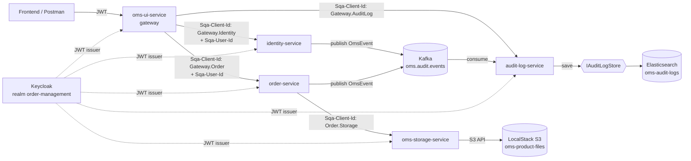

# Order Management System

Microservice-based Order Management application: managing users, orders and products, with asynchronous audit-log communication through Apache Kafka and authentication/authorization through Keycloak.

## Architecture

Five Spring Boot (3.2.4, Java 17) services + a shared event-contract module:

| Service | Port | Alias | Responsibility | Database |
|---|---|---|---|---|
| `oms-ui-service` | 8084 | `gateway.oms.local` | API gateway / BFF — **the only service the frontend knows about** | — (stateless) |
| `identity-service` | 8081 | `identity.oms.local` | Users, groups, permissions | PostgreSQL (`identity_db`) |
| `order-service` | 8082 | `order.oms.local` | Orders, order items, products and their documentation | PostgreSQL (`order_db`) |
| `audit-log-service` | 8083 | `audit-log.oms.local` | Kafka consumer — audit log (write + search) | Elasticsearch |
| `oms-storage-service` | 8085 | `storage.oms.local` | Upload/download/presigned-url for files on S3 (LocalStack) | — (stateless) |
| `oms-common-events` | — | — | Shared Kafka event contract (`OmsEvent`), not a standalone service | — |



Every backend service is itself a full OAuth2 resource server (it validates the Keycloak JWT directly) — this stays active to support direct Postman/debug calls that bypass the gateway. Real authorization (which role can do what) is done by the gateway based on the caller's real JWT; when the gateway then calls the backend services, it sends `Sqa-Client-Id` (the service identity the backend service trusts) + `Sqa-User-Id` (base64 JSON `{"userId","authorities"}` — the user context, since the backend has no real JWT at that point).

## Kafka

- **Topic:** `oms.audit.events` — one topic for all entities (not one topic per service).
- **Partitions:** 3. **Message key:** `entityId` — all events of the same entity end up on the same partition and keep their order.
- **Producer reliability:** the event is published only after the transaction commits (`@TransactionalEventListener(phase = AFTER_COMMIT)`), never from inside a `@Transactional` method's body — this prevents logging changes that were never actually persisted.
- **Idempotency:** `audit-log-service` checks `existsByEventId` before writing — a redelivery after a crash/rebalance is safe.
- **Errors / DLT:** `DefaultErrorHandler` + `ExponentialBackOffWithMaxRetries` (3 attempts), then `DeadLetterPublishingRecoverer` → `oms.audit.events.DLT`.
- **Event format** (`com.sqa.oms.common.events.OmsEvent`): `eventId, eventType (e.g. "ORDER_CREATED"), action (CREATE|UPDATE|DELETE), entityType, entityId, sourceService, performedBy, timestamp, payload`.

## Keycloak

Realm `order-management` (imported from `development/docker-mounts/keycloak/oms-realm.json`).

### Roles

`ORDER_READ`, `ORDER_WRITE`, `ORDER_DELETE`, `USER_READ`, `USER_MANAGE`, `AUDIT_READ`, `PRODUCT_READ`, `PRODUCT_WRITE` — each role has an identically named client scope + a `scopeMappings` entry, so Keycloak places the permission directly in the JWT `scope` claim, and Spring Security's default JWT converter automatically turns it into a `SCOPE_<name>` authority — no need for a custom `JwtAuthenticationConverter`.

### Groups

| Group | Roles |
|---|---|
| `OMS_ADMIN` | all |
| `OMS_MANAGER` | `ORDER_READ`, `ORDER_WRITE`, `ORDER_DELETE`, `USER_READ`, `PRODUCT_READ`, `PRODUCT_WRITE` |
| `OMS_CUSTOMER` | `ORDER_READ`, `ORDER_WRITE`, `PRODUCT_READ` (only over its own orders) |
| `OMS_AUDITOR` | `AUDIT_READ`, `ORDER_READ`, `USER_READ`, `PRODUCT_READ` |

### Test users (always present in the realm import)

| Username | Password | Group |
|---|---|---|
| `admin` | `admin` | `OMS_ADMIN` |
| `manager.oms` | `manager.oms` | `OMS_MANAGER` |
| `customer.oms` | `customer.oms` | `OMS_CUSTOMER` |
| `auditor.oms` | `auditor.oms` | `OMS_AUDITOR` |

Startup details, hosts aliases and obtaining a token: [`development/README.md`](development/README.md).

## Customer-scoped filtering of orders

A caller is "elevated" (sees every order) if their authorities contain `SCOPE_ORDER_DELETE` or `SCOPE_USER_READ` or `SCOPE_AUDIT_READ` — this covers the admin/manager/auditor roles; `OMS_CUSTOMER` has none of these, so its queries are filtered by `customerId == caller.userId`. This is implemented in `order-service` through the `ICallerContext` abstraction, which resolves the identity either from the real JWT (direct access) or from the `Sqa-User-Id` header (access through the gateway).

## SOLID

| Principle | Where in the code |
|---|---|
| **S**ingle Responsibility | Every module: `Controller` → `Service` (interface+`impl`) → `Repository` → `Entity`; `KafkaDomainEventPublisher` only sends messages, it knows nothing about the domain |
| **O**pen/Closed | The `IAuditLogStore` abstraction is designed so that a new storage implementation (e.g. a different search engine) would not require changes to `AuditEventConsumer` or the REST layer — only a new class behind the same interface |
| **L**iskov Substitution | The service/controller depend only on `IAuditLogStore` and the `AuditLogEntry`/`AuditLogSearchRequest` objects, never directly on `AuditLogDocument` — a future replacement implementation would be fully substitutable without changing the caller |
| **I**nterface Segregation | `IDomainEventPublisher.publish(OmsEvent)` — the publisher is separated from the domain service; `ICloudStorageService` in `oms-storage-service` only has upload/download/delete/presign, nothing domain-specific |
| **D**ependency Inversion | The domain services (`identity-service`, `order-service`) depend on `IDomainEventPublisher`, never directly on `KafkaTemplate`; `order-service` depends on the `StorageClient`/`ICallerContext` abstractions, not on concrete WebClient/JWT details |

## Technical decisions and alternatives

- **A single Kafka topic (`oms.audit.events`) instead of one topic per service** — simpler for `audit-log-service` (one consumer, one schema), while per-entity ordering is still guaranteed by keying on `entityId`. The alternative (one topic per service) would be preferable if the services had completely different event schemas or different retention requirements — that is not the case here.
- **The outbox pattern is not implemented in V1** — `@TransactionalEventListener(AFTER_COMMIT)` is used instead, which guarantees the event is never sent before the commit, but does not guarantee it will *definitely* be sent if the broker is unreachable at that exact moment (there is no persistent "outbox" row that a relay process could later retry). The outbox pattern would be the next step if reliability needs to be stronger than "best effort on commit" — especially relevant if Kafka has longer downtime periods.
- **Elasticsearch as the sole audit store (not just a V2 option, and without a parallel relational database)** — `audit-log-service` has no Postgres/JPA at all, it stores directly in Elasticsearch (index `oms-audit-logs`), per explicit requirement. The `IAuditLogStore` abstraction is kept in front of `ElasticsearchAuditLogStore` so that swapping the storage technology would remain possible without changing `AuditEventConsumer` or the REST layer, but in this version there is only one implementation — no redundant relational database that nobody reads.
- **`oms-storage-service` is stateless** (no database of its own) — unlike the analogous `data-storage` service in the reference architecture (which duplicates metadata both in its own database and at the caller), here `order-service` is the single source of truth for `ProductDocument` metadata (fileName, contentType, s3Key, s3Url) — redundancy was consciously avoided.
- **A presigned URL is not stored as permanently valid** — `order-service` regenerates the GET presigned URL on every read of the document list instead of trusting a previously stored URL (which may have expired).
- **`identity-service` does not call the Keycloak Admin API** — although this was suggested in the original task description, the implementation follows the actual architecture of the reference `identity` service: Keycloak and `identity-service`'s local Postgres database are two independent sources of truth, synchronized only by naming convention (the same `entity_id` as the Keycloak `user_id` attribute, the same permission names as Keycloak client scopes). This is more consistent with the rest of the architecture and simpler than maintaining a service-account Admin API integration.
- **Additional functionality beyond the original task description** — `order-service` has a `Product`/`ProductDocument` module with product documentation upload to S3 (through a dedicated `oms-storage-service`), and a separate gateway/BFF service (`oms-ui-service`) in front of the whole system — both were requested explicitly during development, beyond the original "Zadatak_Order_Management_Mikroservisi" description.

## Running

```bash
cd development
cp .env.example .env
docker compose up -d
```

Then (order matters — `oms-common-events` first, the other services depend on it in the local `.m2`):

```bash
cd oms-common-events && mvn clean install
cd ../identity-service && mvn spring-boot:run
cd ../order-service && mvn spring-boot:run
cd ../audit-log-service && mvn spring-boot:run
cd ../oms-storage-service && mvn spring-boot:run
cd ../oms-ui-service && mvn spring-boot:run
```

Hosts alias setup and infrastructure details: [`development/README.md`](development/README.md). Postman collection for testing every endpoint: [`postman/order-management.postman_collection.json`](postman/order-management.postman_collection.json).

## Repository structure

```
order-management-app/
├── development/              # docker-compose, Keycloak realm, DB/LocalStack init scripts
├── oms-common-events/        # shared Kafka event contract (shared Maven dependency)
├── identity-service/
├── order-service/
├── audit-log-service/
├── oms-ui-service/           # gateway / BFF
├── oms-storage-service/      # S3 file storage
└── postman/
```
